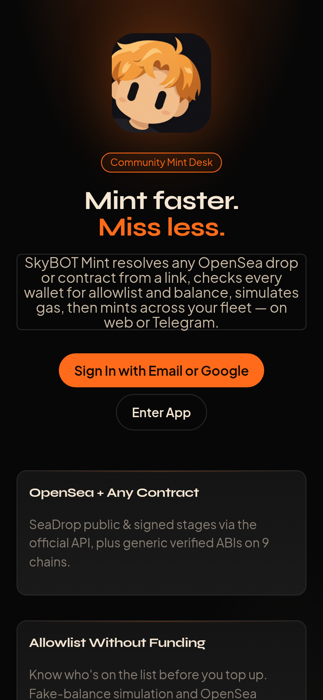
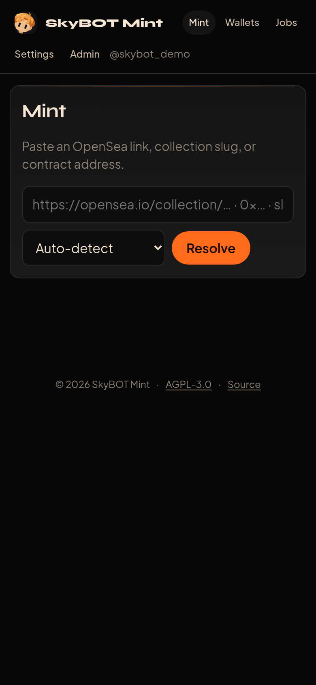
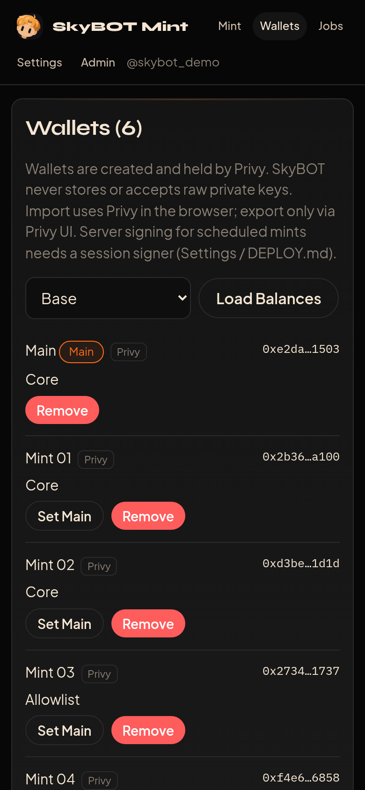
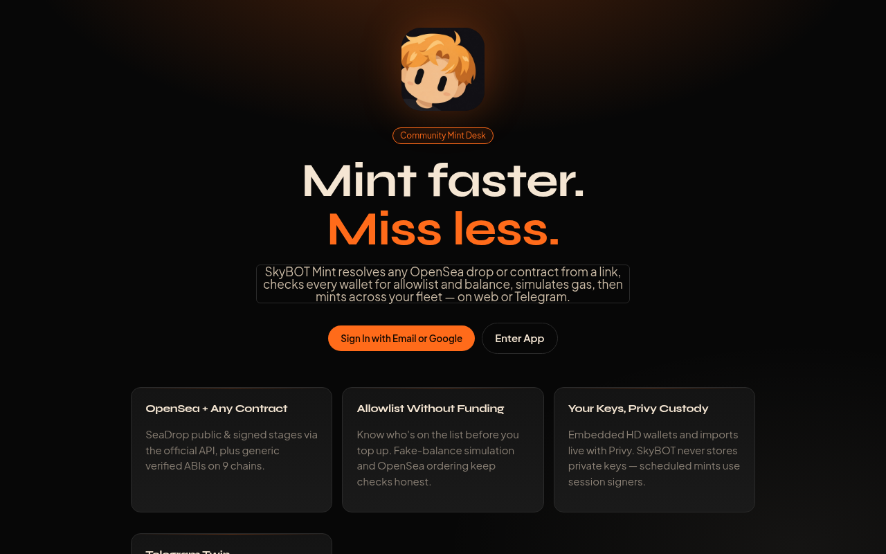
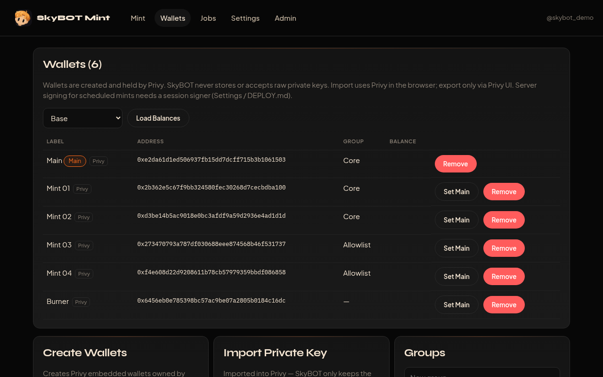
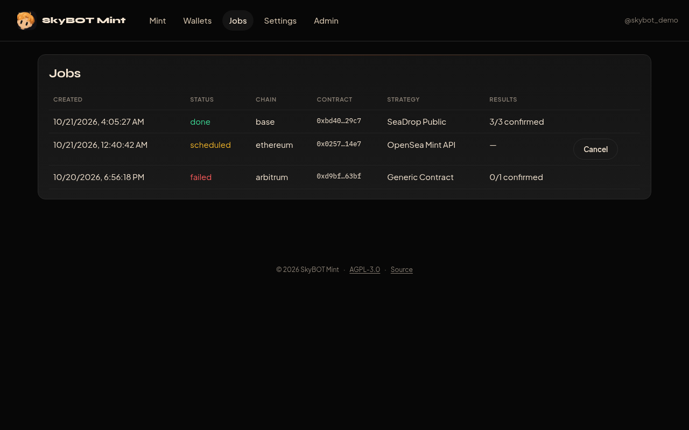
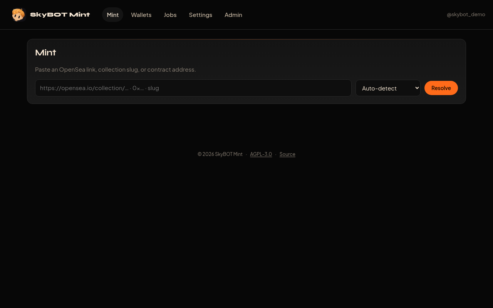
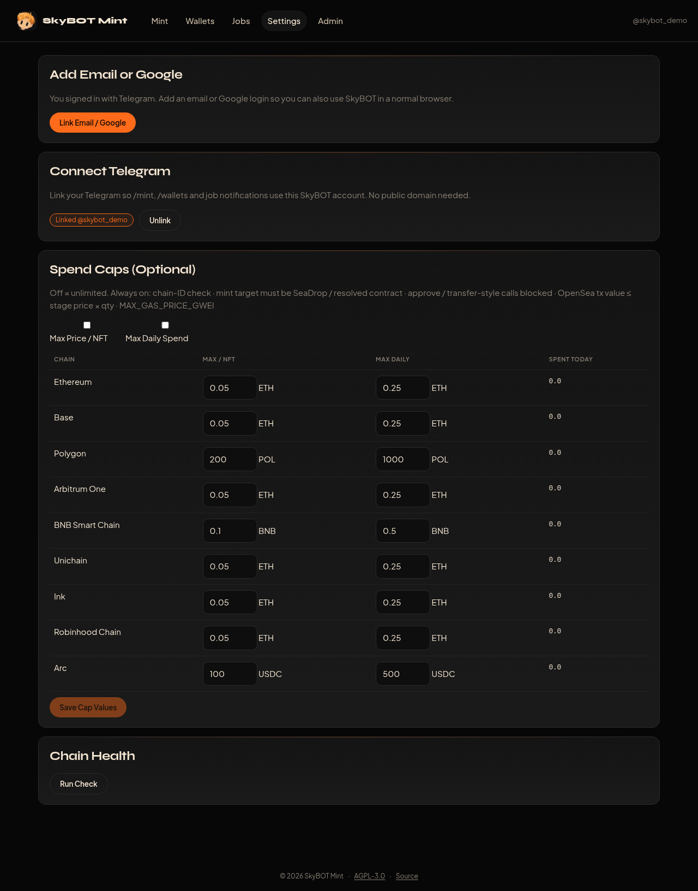
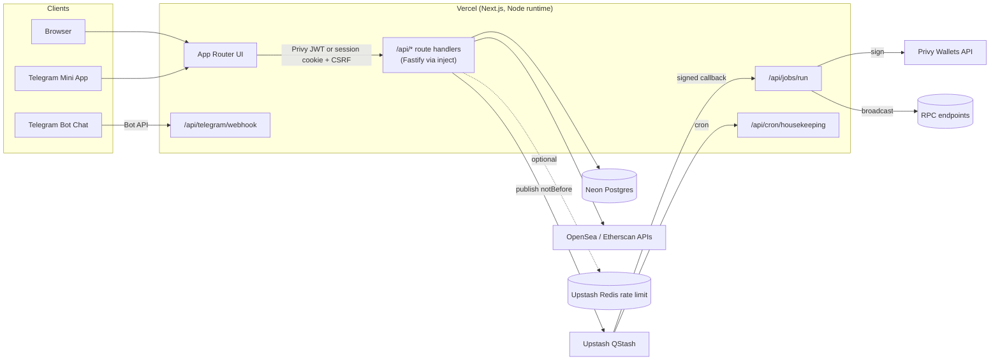

<div align="center">


# SkyBOT Mint

**Multi-user NFT mint desk for OpenSea drops and any NFT contract — on the web and inside Telegram.**

[](LICENSE)
[](https://nextjs.org)
[](https://www.typescriptlang.org)
[](https://vercel.com/new/clone?repository-url=https%3A%2F%2Fgithub.com%2FSkyzee2704%2Fskybot-mint&root-directory=web)
[](https://github.com/Skyzee2704/skybot-mint/actions/workflows/ci.yml)

</div>

---

SkyBOT Mint lets a community mint NFT drops quickly and safely from many wallets at once. Paste an OpenSea link or a contract address, check which wallets are eligible, simulate, and mint now or schedule it to fire at the exact stage start. Wallets are custodied by [Privy](https://privy.io), so **raw private keys never touch SkyBOT's servers, database, or logs**.

## Features

- **Drop resolver**: OpenSea collection or drop URLs, SeaDrop contracts, and any generic `mint` function. Stages, prices, and limits are detected automatically.
- **Wallet eligibility**: allowlist checks without funding (OpenSea ordering, `stateOverride` simulation, Merkle proofs) and per-wallet balance and limit checks.
- **Simulation first**: every mint is simulated before it is signed. Approve, transfer, and `setApprovalForAll` calls are blocked.
- **Scheduled mints**: Upstash QStash fires a few seconds early, then the function pre-signs and waits until the stage starts before broadcasting.
- **Multi-RPC broadcast**: signed transactions go to every configured RPC in parallel, with public RPC fallbacks.
- **Privy custody**: embedded and server wallets, client-side key import and export, and server signing only through Privy authorization keys.
- **Telegram Mini App**: the full dashboard opens inside Telegram with seamless login, native MainButton confirm, BackButton, haptics, and theme colors.
- **Telegram bot**: same account as the web (Privy Telegram sign-in), read-only `/check` for every wallet's eligibility, `/mint` to open a drop in the Mini App, wallets and jobs lists, and notifications when mints finish. Times use your own timezone.
- **Multi-user and admin**: per-user data scoping, Fund Wallets (split native coin from Main to your other wallets), optional spend caps, and an admin user list.
- **Serverless-native**: a single Vercel project with Neon Postgres, QStash, and optional Upstash Redis rate limits.

## Screenshots

> Screenshots use demo data (random addresses, sample jobs).

| Landing                                                                               | Telegram Mini App: Mint                                                                         | Telegram Mini App: Wallets                                                                       |
| ------------------------------------------------------------------------------------- | ----------------------------------------------------------------------------------------------- | ------------------------------------------------------------------------------------------------ |
|  |  |  |



| Wallets                                                                 | Jobs                                                              |
| ----------------------------------------------------------------------- | ----------------------------------------------------------------- |
|  |  |

| Mint                                                              | Settings                                                                                                    |
| ----------------------------------------------------------------- | ----------------------------------------------------------------------------------------------------------- |
|  |  |

## Architecture



## Supported Chains

| Chain           | Chain ID | Native | Env key         |
| --------------- | -------: | ------ | --------------- |
| Ethereum        |        1 | ETH    | `RPC_ETHEREUM`  |
| Base            |     8453 | ETH    | `RPC_BASE`      |
| Polygon         |      137 | POL    | `RPC_POLYGON`   |
| Arbitrum One    |    42161 | ETH    | `RPC_ARBITRUM`  |
| BNB Smart Chain |       56 | BNB    | `RPC_BNB`       |
| Unichain        |      130 | ETH    | `RPC_UNICHAIN`  |
| Ink             |    57073 | ETH    | `RPC_INK`       |
| Robinhood Chain |     4663 | ETH    | `RPC_ROBINHOOD` |
| Arc             |     5042 | USDC   | `RPC_ARC`       |

To add a chain, add an entry to `server/src/config/chains.ts` and set `RPC_<KEY>`.

## Tech Stack

| Layer            | Technology                                                                 |
| ---------------- | -------------------------------------------------------------------------- |
| Web              | Next.js 16 (App Router), React 19, TypeScript                              |
| API              | Fastify, served from Next.js route handlers (Node runtime)                 |
| Auth and custody | Privy (`@privy-io/react-auth`, `@privy-io/node`), Telegram WebApp initData |
| Chain            | ethers v6, multi-RPC broadcast                                             |
| Database         | Drizzle ORM with Neon Postgres (prod), SQLite (local), and PGlite (tests)  |
| Scheduling       | Upstash QStash (prod), in-process emulation (local)                        |
| Rate limits      | Upstash Redis `@upstash/ratelimit`, with an in-memory fallback             |
| Telegram         | grammY (webhook on Vercel, long polling locally)                           |
| Tooling          | Vitest, ESLint, Prettier, and GitHub Actions                               |

## Quick Start (Local Development)

Requirements: Node.js 20.9 or newer and npm 10 or newer.

```bash
git clone https://github.com/Skyzee2704/skybot-mint.git
cd skybot-mint
npm ci
cp .env.example .env        # fill in Privy, Telegram, and RPC values
npm run build               # builds server + web
npm run dev                 # Next.js dev server on http://localhost:3000 (UI + API)
npm run dev:worker          # separate terminal: Telegram polling + local scheduler
```

Without `DATABASE_URL`, data is stored in SQLite under `DATA_DIR`. Without QStash keys, scheduled mints run in the local worker. A `pm2` setup is in `ecosystem.config.cjs`:

```bash
pm2 start ecosystem.config.cjs   # skybot-web (next start) + skybot-worker
```

Useful scripts:

| Command                  | Description                                                                                  |
| ------------------------ | -------------------------------------------------------------------------------------------- |
| `npm run typecheck`      | TypeScript checks for server and web                                                         |
| `npm run lint`           | ESLint (zero warnings in CI)                                                                 |
| `npm run format`         | Prettier                                                                                     |
| `npm test`               | Vitest suite (auth, cross-user authz, initData forgery, safety, resolver, serverless/QStash) |
| `npm run migrate`        | Apply database migrations to `DATABASE_URL`                                                  |
| `npm run telegram:setup` | Set the webhook, commands, and menu button (after deploy)                                    |

## Deployment

SkyBOT Mint deploys as **one Vercel project** with Neon Postgres and Upstash QStash. In short:

1. Push to GitHub and import into Vercel with **Root Directory = `web`**.
2. Create a Neon database and an Upstash QStash project, plus Redis if you want shared rate limits.
3. Set the environment variables, deploy, then run the Telegram webhook setup.
4. Configure Privy (email, Google and Telegram login, allowed origins) and BotFather (Telegram OAuth credentials, `/setdomain`).

See **[DEPLOY.md](DEPLOY.md)** for the full step-by-step guide.

## Configuration

All variables are listed in [`.env.example`](.env.example). The main ones:

| Variable                                                                | Required | Description                                                     |
| ----------------------------------------------------------------------- | :------: | --------------------------------------------------------------- |
| `NEXT_PUBLIC_PRIVY_APP_ID`                                              |    ✅    | Privy App ID (public)                                           |
| `PRIVY_APP_SECRET`                                                      |    ✅    | Privy App secret (server only)                                  |
| `PRIVY_AUTH_PRIVATE_KEY`                                                |    ✅    | Privy authorization key used for server-side signing            |
| `PRIVY_AUTH_KEY_QUORUM_ID`                                              |    ✅    | Key quorum ID added as signer on user wallets                   |
| `PUBLIC_URL`                                                            |    ✅    | Public HTTPS URL of the deployment (Mini App, deep links, CORS) |
| `SESSION_SECRET`                                                        |    ✅    | HMAC secret for Telegram-first session cookies                  |
| `DATABASE_URL`                                                          | ✅ prod  | Neon Postgres connection string                                 |
| `QSTASH_TOKEN`, `QSTASH_CURRENT_SIGNING_KEY`, `QSTASH_NEXT_SIGNING_KEY` | ✅ prod  | Scheduling and signature verification                           |
| `TELEGRAM_BOT_TOKEN`, `TELEGRAM_BOT_USERNAME`                           |    ✅    | Telegram bot                                                    |
| `TELEGRAM_WEBHOOK_SECRET`                                               | ✅ prod  | Secret token used to verify webhook calls                       |
| `ADMIN_EMAILS`, `ADMIN_TELEGRAM_IDS`, `TELEGRAM_USER_ID`                |    —     | Admin users and notification target                             |
| `OPENSEA_API_KEY`, `ETHERSCAN_API_KEY`                                  |    ✅    | Drop resolution and ABI lookup                                  |
| `RPC_<CHAIN>`                                                           |    —     | Private RPC URLs per chain (public fallbacks built in)          |
| `UPSTASH_REDIS_REST_URL`, `UPSTASH_REDIS_REST_TOKEN`                    |    —     | Distributed rate limiting                                       |
| `JOB_LEAD_MS`, `JOB_MAX_DURATION_SEC`                                   |    —     | Scheduler timing (defaults 20000 ms / 300 s)                    |
| `MAX_PRICE_PER_NFT`, `MAX_DAILY_SPEND`, `MAX_GAS_PRICE_GWEI`            |    —     | Global safety limits                                            |
| `NEXT_PUBLIC_SOURCE_URL`                                                |    —     | Repository URL for the footer "Source" link (AGPL)              |

## Security Model

- **No raw keys on our side.** Wallets live in Privy. Import and export happen client-side through Privy's UI, and the server-side import endpoint is disabled.
- **Constrained server signing.** Transactions are signed only through Privy authorization keys. Dangerous selectors are denied, and Privy policies should restrict targets, chains, and value.
- **Authentication on every private route**: a Privy JWT, or a short-lived httpOnly session cookie plus a CSRF header for Telegram-first users. Telegram initData is HMAC-verified with an `auth_date` max age.
- **One account per person**: email, Google and Telegram are linked in Privy and resolve to a single SkyBOT account; accounts that own wallets are never merged automatically.
- **Per-user data scoping**, rate limits, strict CORS, CSP and security headers, Zod input validation, and redacted logs.
- **Signed callbacks**: QStash signatures are verified on job and cron routes, and the Telegram webhook requires a secret token.

Read the full threat model and production checklist in **[SECURITY.md](SECURITY.md)**.

## Telegram Bot Commands

| Command                  | Description                                                                          |
| ------------------------ | ------------------------------------------------------------------------------------ |
| `/start`                 | Welcome message and **Open Dashboard** button (Mini App, signs you in with Telegram) |
| `/check <link\|address>` | Read-only: stages (price, limit, time in your timezone) and per-wallet eligibility   |
| `/mint <link\|address>`  | Resolve a drop and open it in the dashboard                                          |
| `/wallets`               | List your wallets                                                                    |
| `/jobs`                  | Show recent and scheduled mints                                                      |
| `/withdraw`              | Open the Withdraw page                                                               |
| `/help`                  | How to use SkyBOT Mint                                                               |

## Project Structure

```
.
├── web/                      # Next.js app (deployed to Vercel, Root Directory = web)
│   ├── app/                  # pages: /, /app/{mint,wallets,jobs,settings,admin}, /source
│   │   └── api/              # [...path] (Fastify adapter), jobs/run, cron/housekeeping
│   ├── components/           # AppShell, Confirm, SiteFooter, …
│   ├── lib/                  # Privy + Telegram providers, API client, theme
│   └── vercel.json           # function durations
├── server/                   # @nft-mint-bot/server: API, mint engine, bot, scheduler
│   ├── src/api/              # Fastify routes (auth, wallets, mint, jobs, telegram, admin)
│   ├── src/auth/             # Privy, session cookies, middleware
│   ├── src/bot/              # grammY bot, notifications, initData validation
│   ├── src/core/             # resolver, eligibility, simulation, multi-RPC send, safety
│   ├── src/db/               # Drizzle schema + client (Postgres / SQLite / PGlite)
│   ├── src/jobs/             # QStash scheduler + signature verification
│   ├── src/scripts/          # migrate, telegram-setup
│   ├── src/local.ts          # local worker (polling + scheduler emulation)
│   └── test/                 # Vitest suite
├── .github/                  # CI workflow, issue and PR templates
├── assets/ screenshots/      # logo and screenshots
└── ecosystem.config.cjs      # pm2 (local testing)
```

## Roadmap

- [x] v1.0: multi-user mint desk, Privy custody, Telegram Mini App, Vercel and QStash
- [ ] Privy wallet policies managed from the admin UI
- [ ] Withdraw and sweep with fresh re-authentication (MFA or passkey)
- [ ] More launchpads (Zora, Magic Eden, Manifold) and more chains
- [ ] **Token trading** (swaps and snipes) from the same wallets and bot
- [ ] Per-job analytics and gas reports

## Contributing

Contributions are welcome — open an [issue](https://github.com/Skyzee2704/skybot-mint/issues) or a [pull request](https://github.com/Skyzee2704/skybot-mint/pulls). Please read [CONTRIBUTING.md](CONTRIBUTING.md) and our [Code of Conduct](CODE_OF_CONDUCT.md). Report security issues privately as described in [SECURITY.md](SECURITY.md).

## License

Copyright (C) 2026 SkyBOT Mint. See [NOTICE](NOTICE).

SkyBOT Mint is free software: you can redistribute it and/or modify it under the terms of the **GNU Affero General Public License, version 3 only** ([AGPL-3.0-only](LICENSE)).

If you run a modified version of SkyBOT Mint as a network service, AGPL §13 requires you to offer your users the corresponding source code. The web footer includes a **Source** link for this purpose, configured with `NEXT_PUBLIC_SOURCE_URL`.

## Disclaimer

SkyBOT Mint is provided **"as is", without warranty of any kind**. Nothing in this project is financial advice. Minting NFTs and interacting with smart contracts carries risk: contracts may be malicious, buggy, or behave differently than simulated, and transactions are irreversible. You are solely responsible for your wallets, funds, and the transactions you sign. **Use at your own risk.**
